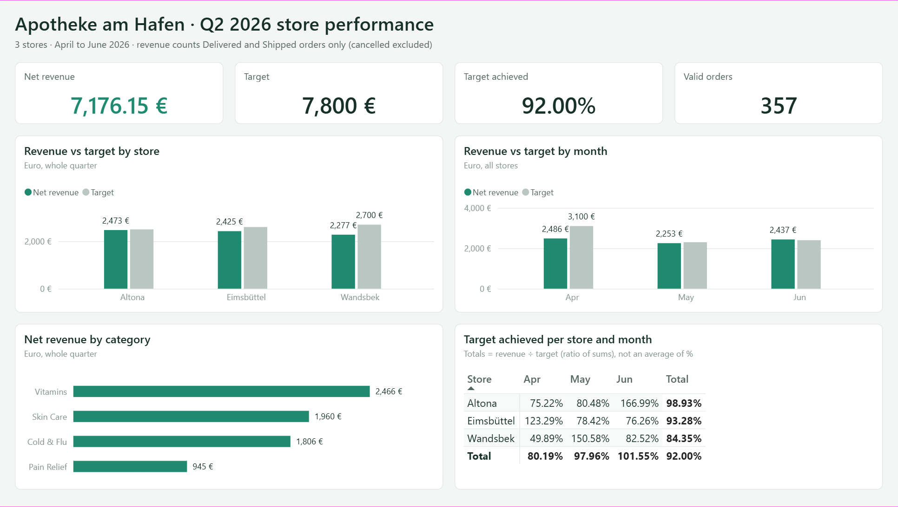
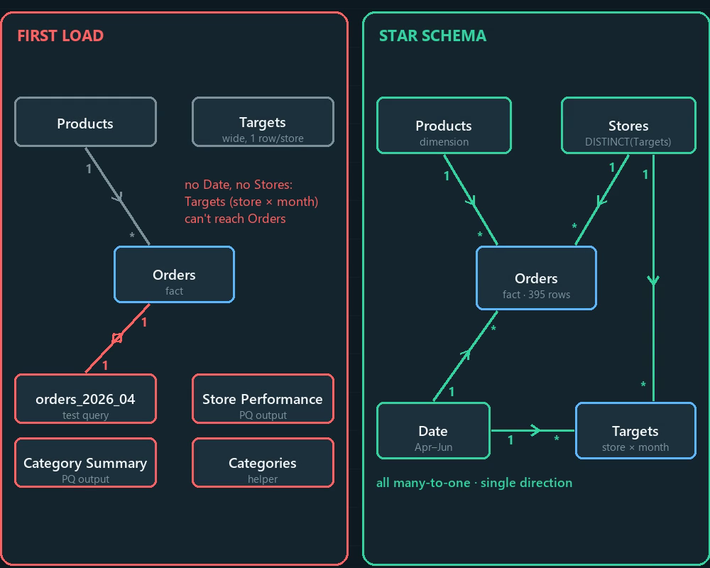

# Apotheke am Hafen: Power Query + Power BI Challenge

Three monthly order exports from a fictional Hamburg pharmacy chain, full of the mess real exports have, cleaned in **Power Query** and modelled in **Power BI** as a star schema with explicit **DAX** measures.

**Business questions**
1. Which stores hit their monthly net revenue target in Q2 2026 (April to June)?
2. Which product category brings in the most net revenue?



**Video:** [13 mistakes I made on the way, and how to avoid them](media/PowerQuery_PowerBI_13_Mistakes.mp4) (2:32, no audio)

All data in this repo is **synthetic**, generated for this exercise. The stores, customers and orders are not real.

---

## What's in the repo

```
data/
  challenge/                 <- used by the Power BI project
    orders/orders_2026_04.csv, _05, _06   one shop-system export per month
    products.xlsx            sheets "Products" and "Categories"
    targets.xlsx             sheet "Targets 2026", months as columns (wide)
  practice/                  <- warm-up lab (done in Excel Power Query)
    sales/sales_2026_01.csv, _02, _03     German-format sales exports
    products.csv, budget_2026.csv
powerbi/
  Apotheke_Q2.pbip           Power BI project (open this)
  Apotheke_Q2.SemanticModel  model, Power Query (M) and DAX measures as TMDL
  Apotheke_Q2.Report         the report page as PBIR JSON
answer_key/ANSWER_KEY.txt    expected results to check your own solution
CHALLENGE_BRIEF.txt          scenario, rules, checkpoints and hints if you want to try it yourself
media/                       dashboard screenshot + the video
```

## How to open it

1. Clone or download the repo.
2. Open `powerbi/Apotheke_Q2.pbip` in Power BI Desktop (a recent version with PBIP/TMDL support).
3. **Home → Transform data → Edit parameters → `DataFolder`**: set it to the `data\challenge` folder of your copy, for example
   `C:\...\ApothekePowerQueryChallenge\data\challenge`
4. Click **Refresh**. The project ships without a data cache, so the visuals stay blank until the first refresh.

## What makes the data messy

| Problem in the source | How it is handled in Power Query |
|---|---|
| Title + period lines above the header, a footer with "Rows exported: N" | Skip top rows, then filter on a rule: a real order always has an Order ID |
| Store name only on the first row of each block, empty cells arrive as `""` | Replace `""` with `null`, then Fill Down |
| Prices as `€ 12,50`, `12,50 €`, `€12,50` (German decimals) | Convert with the **de-DE** locale on the first type conversion |
| SKUs as `sku-0023`, `SKU-0041 ` | Trim + Uppercase before merging with Products |
| Status as `DELIVERED`, `delivered `, `Canceled` / `Cancelled` | Trim + Capitalize Each Word, then standardise the spelling |
| The same order sent twice, differing only in Status formatting | Clean Status **first**, then Remove Duplicates on Order ID |
| `"Müller, Anna"` in one column, names with ü, ä, ı | UTF-8 at the source, split on `", "` |
| Targets in wide format with a title row and a note at the bottom | Remove top rows, promote headers, rule-based filter, Unpivot |
| Three monthly files | **From Folder**: one cleaning function runs on every file. A July export works after Refresh |

## Data model



- **Facts:** `Orders` (one row per unique order) and `Targets` (one row per store × month)
- **Dimensions:** `Products`, `Stores` (`DISTINCT(Targets[Store])`) and `Date` (Apr–Jun 2026, Month sorted by Month No)
- All relationships are many-to-one and filter in a single direction. Targets can't join Orders directly (store × month vs. order level), so both facts share the `Stores` and `Date` dimensions.

**Measures**

```DAX
Total Net Revenue = SUM ( Orders[Net Revenue] )
Valid Net Revenue = CALCULATE ( [Total Net Revenue], Orders[Status] IN { "Delivered", "Shipped" } )
Valid Orders      = CALCULATE ( COUNTROWS ( Orders ), Orders[Status] IN { "Delivered", "Shipped" } )
Total Target      = SUM ( Targets[Target EUR] )
Achievement %     = DIVIDE ( [Valid Net Revenue], [Total Target] )
Gap to Target     = [Valid Net Revenue] - [Total Target]
```

Achievement % has to be a measure. Totals then become a ratio of sums: Altona reached **98.93%** of its quarterly target. Averaging its three monthly percentages would claim 107.6%.

## Results

| | |
|---|---|
| Unique orders (after removing 18 re-sent duplicates) | **395** |
| Valid orders (Delivered + Shipped) | **357** |
| Net revenue, valid orders | **7,176.15 €** |
| Q2 target | **7,800 €** |
| Target achieved | **92.00%** |

- No store hit its quarterly target: Altona 98.93%, Eimsbüttel 93.28%, Wandsbek 84.35%.
- Only 3 of the 9 store-months were on target: Altona in June, Eimsbüttel in April, Wandsbek in May.
- **Vitamins** bring in the most net revenue (2,465.58 €), ahead of Skin Care, Cold & Flu and Pain Relief.

All 9 store-month values match `answer_key/ANSWER_KEY.txt`.

## 13 lessons learned

1. **The first type conversion wins.** A Whole Number step before the de-DE locale silently turned `8,94` into `894`.
2. **Fill Down only fills null.** Replace empty text with null first.
3. **Replace Values is case-sensitive**, and a new step is inserted after the *selected* step, not at the end.
4. **Filter by rules, not row numbers.** "Delete row 141" only works for one file.
5. **The preview is not the data.** The grid draws 100 rows at a time. Prove counts with Count Rows.
6. **Clean before you deduplicate.**
7. **M syntax:** every step ends with a comma except the last one, and `in` returns the step you name.
8. **Deleting a step** breaks every step (and the `in` clause) that still refers to it.
9. **From Folder:** keep all cleaning inside the Transform file function, never in the combined query.
10. **Table.ExpandTableColumn returns type any.** Set types again at the end.
11. **Load only what the model needs.** A forgotten test query created a 1:1, two-way relationship.
12. **A ratio must be a measure** (ratio of sums, not an average of percentages).
13. **Format before you screenshot:** € instead of the en-GB £, and Display units: None instead of "8K".

The video walks through each one with a before/after example.

## Practice data (warm-up)

`data/practice` is the warm-up lab done in Excel Power Query before the challenge: three German-format sales exports (`;` separator, `55,60` decimals, `dd.mm.yyyy` dates, leading spaces, duplicates and junk rows), a product list and a wide monthly budget. Cleaned result: 412 rows, 218,853.55 € revenue. It covered append, merge and join kinds, custom columns in M, unpivot and a two-key merge.

---

Built as a practice project for the transform side of Power Query, with [Claude](https://claude.ai) as a tutor.
